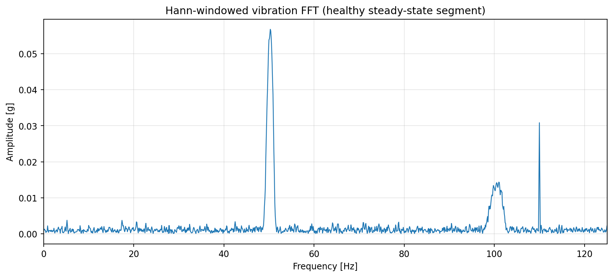
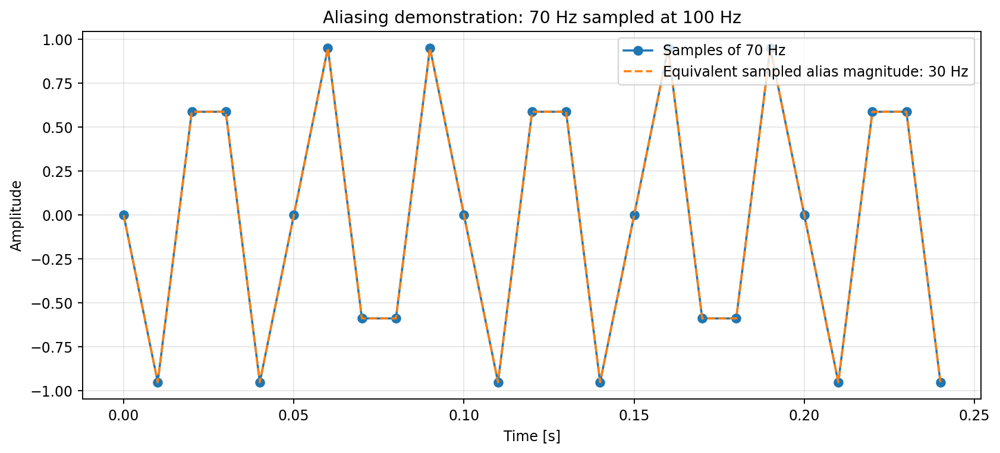
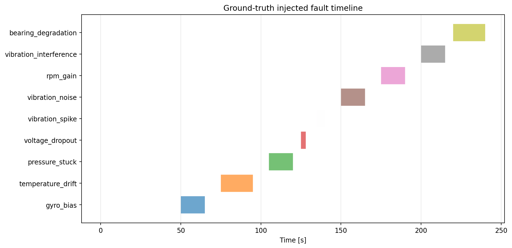
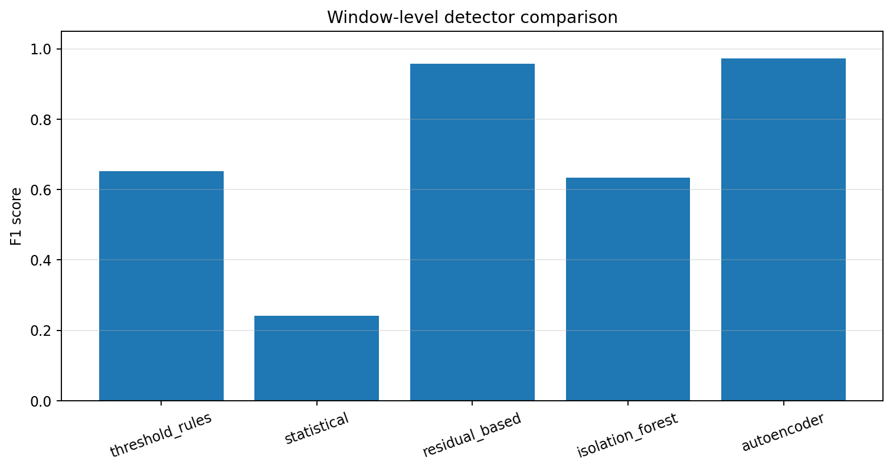

# Engineering Sensor FDIR & Time-Series Analysis Platform

[](https://github.com/savbcar/engineering-sensor-fdir/actions/workflows/ci.yml)


Portfolio-grade signal-processing, fault-detection and anomaly-detection platform for multivariate engineering sensor time-series.

**Core stack:** Python · NumPy · SciPy · pandas · scikit-learn · PyTorch · pytest · GitHub Actions · Docker

## What this project demonstrates

- physics-informed multivariate sensor simulation
- sampling, Nyquist, aliasing and FFT analysis
- Hann windowing and Welch PSD
- Butterworth filter design and response analysis
- time-domain and frequency-domain feature engineering
- bias, drift, stuck, gain, spike, dropout, noise, sinusoidal-interference and slow-degradation fault injection
- fixed threshold rules
- robust statistical anomaly detection
- physics/residual-based detection and fault-specific diagnosis
- Isolation Forest anomaly detection
- PyTorch autoencoder anomaly detection
- precision, recall, F1, false-positive rate, ROC-AUC and detection-delay evaluation
- generated engineering plots, serialized models, tests, CI and container configuration

## Engineering scenario

The synthetic plant represents an electric motor/rotor, bearing/structure and cooling loop instrumented with:

| Channel | Unit | Diagnostic role |
|---|---|---|
| rotational speed | rpm | shaft operating state |
| angular rate | rad/s | redundant rotational measurement |
| temperature | degC | thermal health |
| coolant pressure | bar | cooling-loop health |
| DC bus voltage | V | electrical supply health |
| vibration X/Y | g | rotor/bearing/structural health |

Signals are related by explicit dynamics and algebraic physics. For example, angular velocity and shaft speed satisfy `omega = rpm * 2*pi/60`; temperature follows a first-order thermal response; voltage and pressure depend on operating load; vibration contains shaft-order harmonics and structural modes.

## Fault campaign

The default 240 s run injects nine fault families at known times:

| Fault | Sensor | Type |
|---|---|---|
| gyro bias | gyro | additive bias |
| temperature drift | temperature | gradual drift |
| pressure stuck | pressure | frozen measurement |
| voltage dropout | voltage | missing values |
| vibration spike | acceleration X | impulses |
| vibration noise | acceleration Y | increased broadband noise |
| RPM gain | speed sensor | multiplicative gain error |
| vibration interference | acceleration X | 90 Hz sinusoidal interference |
| bearing degradation | acceleration Y | increasing shaft-order vibration |

Exact labels and a fault manifest are exported with every run.

## Detection architecture

```text
sensor data
   |
   +--> fixed engineering rules --------------------+
   |                                                |
   +--> robust statistical detector ----------------+--> evaluation
   |                                                |
   +--> physics/model residuals --> isolation/ID ----+
   |                                                |
   +--> window features --> Isolation Forest --------+
   |                                                |
   +--> window features --> PyTorch autoencoder -----+
```

The project intentionally does **not** jump straight to deep learning. Deterministic and physics-based methods remain first-class baselines because many safety/reliability faults have signatures that are easier to audit with simple logic.

## Quick start

### Local Python

```bash
python -m venv .venv
source .venv/bin/activate          # Windows PowerShell: .venv\\Scripts\\Activate.ps1
python -m pip install --upgrade pip
pip install -e ".[dev]"
pytest
sensor-fdir --config config/default.json --output artifacts/demo
```

The run writes generated datasets, detector flags, features, models, metrics and PNG figures under `artifacts/demo/`.

### Docker

```bash
docker build -t sensor-fdir .
docker run --rm -v "${PWD}/artifacts:/app/artifacts" sensor-fdir
```

## Repository layout

```text
engineering-sensor-fdir/
├── .github/workflows/ci.yml
├── config/default.json
├── docs/
│   ├── DESIGN_DECISIONS.md
│   ├── ENGINEERING_NOTES.md
│   ├── INTERVIEW_GUIDE.md
│   ├── LIMITATIONS.md
│   └── VALIDATION.md
├── examples/quickstart.py
├── src/sensor_fdir/
│   ├── detectors/
│   ├── config.py
│   ├── evaluation.py
│   ├── faults.py
│   ├── features.py
│   ├── pipeline.py
│   ├── plotting.py
│   ├── signal_processing.py
│   └── simulation.py
├── tests/
├── Dockerfile
├── Makefile
├── LICENSE
└── pyproject.toml
```

## Verified default-run results

The checked-in demo artifacts were generated by the repository itself. On the common 2.0 s / 1.0 s-stride evaluation grid, the verified F1 scores are: residual-based **0.958**, autoencoder **0.973**, Isolation Forest **0.635**, fixed rules **0.652**, and naive robust statistics **0.242**. These are controlled synthetic-benchmark results, not field-performance claims.

Full metrics, fault-specific detection delays and verification status are in `docs/VERIFIED_RESULTS.md`.

## Results gallery

| Vibration FFT | Aliasing demonstration |
|---|---|
|  |  |

| Fault timeline | Detector F1 comparison |
|---|---|
|  |  |

## Important engineering notes

The default sample rate is 250 Hz, so Nyquist is 125 Hz. The injected 90 Hz interference and structural content are kept below this boundary. The plotting/DSP demonstration uses zero-phase `sosfiltfilt`, which is intentionally **offline-only**; a real-time embedded implementation must use causal filtering and account for group delay.

Feature models use 2 s windows with 1.0 s stride. This increases statistical stability but introduces latency and overlapping observations. The repository therefore reports sample-level fault-specific metrics for the residual detector and a separate common window-level comparison for all detector families.

## FDIR scope

**Detection:** implemented for all injected fault families.

**Isolation:** implemented through sensor-specific residual/rule signatures in the controlled scenario.

**Identification:** implemented as named fault-family flags for the controlled injected cases.

**Recovery:** **not implemented.** No claim is made that this repository performs closed-loop reconfiguration or satisfies a safety certification standard.

See `docs/ENGINEERING_NOTES.md` and `docs/LIMITATIONS.md` for the full technical discussion.

## Interview-ready design choices

The project is structured to defend the following decisions:

- FFT is an efficient algorithm for the DFT, not a different transform.
- Frequency resolution is controlled by observation duration (`Delta f = 1/T`), not just sample rate.
- Windowing trades leakage suppression for main-lobe width.
- Butterworth gives a maximally flat passband but is not universally optimal.
- Residuals can be more robust than raw thresholds across changing operating points.
- Simple methods can beat ML when the fault signature is direct and physically defined.
- Precision/recall alone are insufficient; false-positive rate and detection delay matter operationally.
- Unsupervised anomaly detection is not automatically root-cause isolation.

## CV bullets

After reproducing the verified run, this project supports bullets such as:

- Developed an engineering FDIR pipeline for multivariate sensor time-series, implementing physics-informed simulation, nine sensor-fault families, FFT/PSD analysis, Butterworth filtering and time/frequency-domain feature extraction.
- Built and compared rule-based, robust statistical, model-residual, Isolation Forest and PyTorch autoencoder detectors; evaluated precision, recall, F1, false-alarm behavior, ROC-AUC and fault-detection delay on reproducible ground-truth scenarios.
- Designed a GitHub-ready Python package with automated tests, CI, Docker configuration, serialized anomaly models, diagnostic event outputs and documented limitations for transfer to automotive and aerospace condition-monitoring workflows.

## Non-claims

This is a portfolio engineering demonstrator, not a certified diagnostic product. Synthetic performance is not a substitute for validation on independent real hardware data, mission/vehicle operating envelopes, multiple simultaneous faults and deployment-specific timing constraints.
